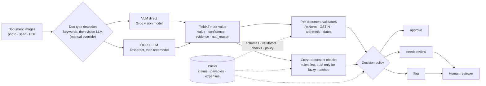
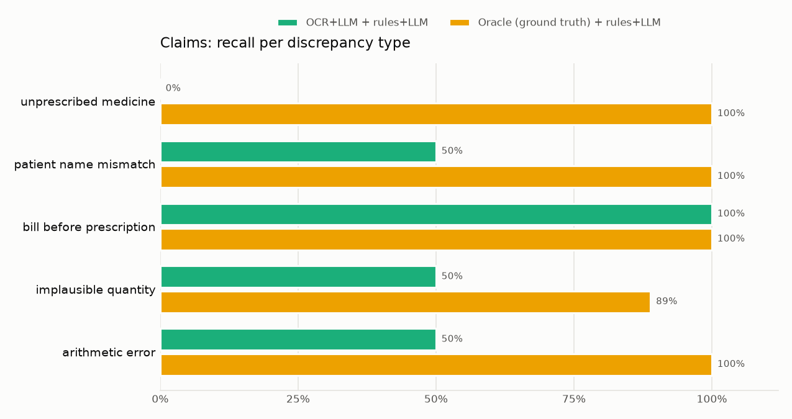
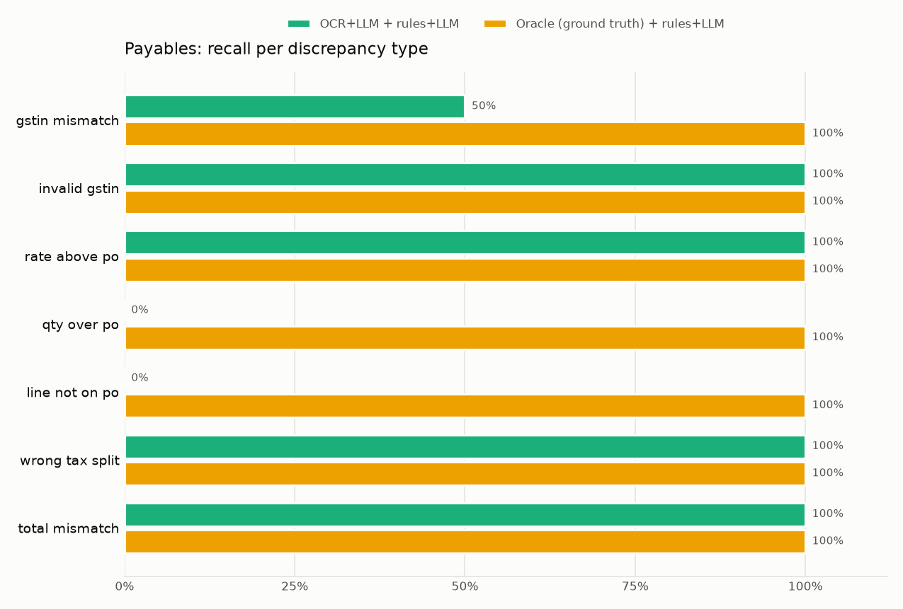

# PaperTrail

[](#deploying)
[](#)
[](.github/workflows/ci.yml)

**Multi-domain document intake with vision LLMs: extraction, validation and cross-document checks for insurance claims and invoice-to-PO matching, benchmarked.**


> _Demo GIF placeholder._ To record one: open the live demo, start a screen recorder (macOS: <kbd>⇧⌘5</kbd>, "Record Selected Portion"; Windows: Xbox Game Bar), click **Claims → "Bill includes a medicine that was not prescribed"**, click a reason's field chip to show the highlight, open the **Benchmark** tab, stop. Convert with `ffmpeg -i demo.mov -vf "fps=12,scale=1100:-1:flags=lanczos" -loop 0 docs/demo.gif` and keep it under ~8 MB.

> **Demo with synthetic data, not for real claims or payments.** Every person, company, GSTIN and amount in this repository is fake.

## Try it in 30 seconds

1. Open the live demo. In the **Demo documents** panel, pick a situation: health insurance claim, supplier invoice
   or employee expense.
2. Click **Try this example** on any card, or drag its two documents into the boxes and press **Check documents**.
   There are 5 synthetic pairs per situation, also in [`examples/`](examples/) and as a zip download in the demo.
3. Read the verdict (looks good / double-check / problem found), then click any row of **What we checked** to
   highlight where it came from in the documents.

The example documents are recognised by their file hash and served from extractions precomputed with the live engine,
so they work instantly even when the free-tier models are at their limit. Your own files go to the live models.

## Why this exists

When a business document leaves the organisation that created it, it travels as a PDF, a scan or a phone photo. The receiver, whether an insurer, an accounts-payable team or a finance desk, has to re-type it and check it by hand: does the bill match the prescription? Does the invoice match the purchase order? Is the GSTIN even valid? Errors and padding hide in exactly those cross-document gaps.

PaperTrail is a general document-intake engine for the receiving side. It:

1. **extracts** structured fields from document images with vision LLMs. Every field carries a confidence, the text it was read from, and, if unreadable, a null with a reason. It never guesses;
2. **validates** every field: drug names against RxNorm, GSTIN checksums, arithmetic, dates, GST slabs and tax split;
3. **cross-checks** related documents against each other (bill vs prescription, invoice vs PO), using deterministic rules first and an LLM only for fuzzy semantic matches;
4. **routes** each case to **approve**, **needs review** or **flag**, with reasons that point at the exact fields.

A human always makes the final call. The engine is generic; each business workflow is a pluggable **pack**.

## Architecture



```
src/papertrail/
  core/                      generic engine: no pack-specific code (a test enforces this)
    fields.py                Field[T]{value, confidence, evidence, null_reason}
    llm.py                   Groq client: per-model RPM/TPM limiter, 429 backoff (retry-after), disk cache, tokens
    extraction/              vlm_direct.py, ocr_then_llm.py, detect.py, prompts.py
    validators/              rxnorm.py, gstin.py, arithmetic.py, dates.py, fuzzy.py, duplicates.py
    matching.py              exact -> normalised -> fuzzy -> unique key -> (optional) LLM verdicts with reasons
    crosscheck.py            rule engine for document-vs-document checks
    decision.py              approve | needs_review | flag + reasons
    pack.py                  Pack interface + auto-discovering registry
  packs/claims|payables|expenses/   schemas.py, validators.py, crosschecks.py, samples/
  web/api.py                 FastAPI: /api/extract, /api/evaluate (the live demo backend)
bench/                       synthetic generator, metrics, runner, report, labelling CLI
public/                      static demo frontend (served from Vercel's CDN)
```

## The packs

| Pack | Documents | Per-document validation | Cross-document checks |
|---|---|---|---|
| **claims** (health-insurance claim intake) | prescription + pharmacy bill | RxNorm lookup with brand→generic normalisation (plus a curated Indian brand map), closest-match suggestion, on-disk cache, timeout and retry; bill arithmetic; date sanity | every billed medicine was prescribed; patient name matches (fuzzy, initials-aware); bill dated on/after the prescription and within 30 days; billed quantity plausible against dose × frequency × duration |
| **payables** (invoice-to-PO matching) | GST tax invoice + purchase order | GSTIN format + checksum; lines sum to taxable value, taxable + taxes = grand total; valid GST slabs for the invoice date (GST 2.0 regime from 22 Sep 2025); CGST = SGST intra-state vs IGST inter-state from GSTIN state codes | vendor GSTIN matches the PO; invoice quotes the PO number; every line is on the PO (description + HSN); billed qty ≤ ordered; rate within 2% of the PO |
| **expenses** (employee reimbursement; demo only, not benchmarked) | receipt + expense claim form | receipt items add up; dates sane; positive amount | claimed amount ≤ receipt total; expense date = receipt date; receipt within the 30-day policy window; merchant matches; duplicate detection via perceptual image hash + (merchant, date, amount) fingerprint |

The expenses pack was built by following [docs/ADDING_A_PACK.md](docs/ADDING_A_PACK.md), with no change to `core/`.

## Benchmark results

<!-- BENCH:START (generated by `python -m bench.report`; do not edit by hand) -->
#### Claims

| Configuration | Pairs | Extraction F1 (exact / norm.) | Discrepancy precision | Discrepancy recall | False alarms on clean pairs | Decision accuracy | Tokens / pair | Model latency p50 / p95 |
|---|---|---|---|---|---|---|---|---|
| VLM direct + rules | TBD | TBD | TBD | TBD | TBD | TBD | TBD | TBD |
| VLM direct + rules+LLM | 45 of 60 | 90.0% / 91.5% | 82.6% | 100.0% | 36.8% | 82.2% | 6,162 | 4.0s / 11.3s |
| VLM B + rules+LLM (no second vision model available on Groq) | TBD | TBD | TBD | TBD | TBD | TBD | TBD | TBD |
| OCR+LLM + rules+LLM | 60 | 70.3% / 72.1% | 55.8% | 65.9% | 33.3% | 36.7% | 3,033 | 4.1s / 9.9s |
| Oracle (ground truth) + rules | 60 | n/a (ground truth) | 67.2% | 97.7% | 46.7% | 76.7% | n/a | n/a |
| Oracle (ground truth) + rules+LLM | 60 | n/a (ground truth) | 95.6% | 97.7% | 6.7% | 96.7% | n/a | n/a |

Field-validation catch rate (VLM direct + rules+LLM): `arithmetic_error` 100.0%



Error attribution (oracle vs real):

| Configuration | Missed: extraction | Missed: matching/logic | False alarm: extraction | False alarm: matching/logic |
|---|---|---|---|---|
| VLM direct + rules+LLM (vs Oracle (ground truth) + rules+LLM) | 0 | 0 | 6 | 2 |
| OCR+LLM + rules+LLM (vs Oracle (ground truth) + rules+LLM) | 14 | 1 | 22 | 1 |

#### Payables

| Configuration | Pairs | Extraction F1 (exact / norm.) | Discrepancy precision | Discrepancy recall | False alarms on clean pairs | Decision accuracy | Tokens / pair | Model latency p50 / p95 |
|---|---|---|---|---|---|---|---|---|
| VLM direct + rules | TBD | TBD | TBD | TBD | TBD | TBD | TBD | TBD |
| VLM direct + rules+LLM | 40 of 60 | 94.7% / 94.8% | 51.1% | 92.0% | 40.0% | 72.5% | 5,497 | 4.7s / 23.0s |
| VLM B + rules+LLM (no second vision model available on Groq) | TBD | TBD | TBD | TBD | TBD | TBD | TBD | TBD |
| OCR+LLM + rules+LLM | 60 | 79.3% / 79.8% | 23.4% | 59.5% | 80.0% | 46.7% | 3,405 | 5.1s / 24.5s |
| Oracle (ground truth) + rules | 60 | n/a (ground truth) | 92.3% | 97.3% | 3.3% | 98.3% | n/a | n/a |
| Oracle (ground truth) + rules+LLM | 60 | n/a (ground truth) | 100.0% | 100.0% | 0.0% | 100.0% | n/a | n/a |

Field-validation catch rate (VLM direct + rules+LLM): `invalid_gstin` 100.0%, `total_mismatch` 100.0%



Error attribution (oracle vs real):

| Configuration | Missed: extraction | Missed: matching/logic | False alarm: extraction | False alarm: matching/logic |
|---|---|---|---|---|
| VLM direct + rules+LLM (vs Oracle (ground truth) + rules+LLM) | 2 | 0 | 22 | 0 |
| OCR+LLM + rules+LLM (vs Oracle (ground truth) + rules+LLM) | 15 | 0 | 72 | 0 |
<!-- BENCH:END -->

Full report: [bench/results/BENCHMARK.md](bench/results/BENCHMARK.md).

### How the benchmark works

- **Data:** 60 claims pairs and 60 payables pairs, generated by `bench/generate_synthetic.py` from seed 7 with exact ground truth.
  - **Tiers:** 40% clean, 35% "scanned" (rotation, blur, JPEG noise, uneven light) and 25% "hard" (heavy noise, low resolution, partial occlusion recorded in the ground truth).
  - **Discrepancies:** half the pairs carry 1–2 seeded discrepancies from a labelled taxonomy, balanced across types.
  - **Built-in traps for naive matchers:** clean pairs mix brand and generic drug names, including real Indian brands that the rule tables don't know, and paraphrased invoice lines that share HSN codes.
- **Dev/test split:** prompts and matchers were tuned on a separate **dev set (seed 1)**; seed 7 is the frozen test set reported here.
- **Configurations:** VLM direct with rules, VLM direct with rules+LLM, and OCR+LLM with rules+LLM. Each is paired with an **oracle** run that feeds ground truth straight into the cross-checker, to separate extraction errors from matching errors. Groq currently offers one vision model, so "VLM model B" is reported as not available.
- **Metrics:**
  - field precision, recall and F1 (exact and normalised; line items matched as sets; occluded fields: a null is never penalised, a guess is);
  - per-type discrepancy precision and recall, and the false-alarm rate on clean pairs;
  - decision confusion matrix;
  - oracle-vs-real error attribution;
  - confidence calibration;
  - latency and tokens per pair.

## VLM vs OCR+LLM, and rules vs rules+LLM: what we learned

TBD: written from the final results.

## Failure analysis

TBD: see the top-10 failure patterns in [BENCHMARK.md](bench/results/BENCHMARK.md#top-failure-patterns).

## Adding a pack

A pack declares its document types and Pydantic schemas, per-document validators, cross-document checks and decision policy, then registers itself. Nothing in `core/` changes. The step-by-step guide is in [docs/ADDING_A_PACK.md](docs/ADDING_A_PACK.md), and `tests/test_pack_registry.py` registers a throwaway pack from outside the package to prove it.

## Running locally

```bash
git clone <this repo> && cd papertrail
python3.11 -m venv .venv && source .venv/bin/activate
pip install -e ".[dev]"
brew install tesseract            # or: apt-get install tesseract-ocr  (only for the OCR pipeline)
cp .env.example .env              # add GROQ_API_KEY from console.groq.com
python scripts/build_web.py       # copy samples + benchmark into public/
uvicorn app:app --port 7860       # http://localhost:7860
```

Or with Docker (includes Tesseract):

```bash
docker build -t papertrail . && docker run --rm -p 7860:7860 --env-file .env papertrail
```

Tests (offline: the LLM and HTTP are mocked) and lint: `pytest && ruff check .`

### Choosing models

Model names are configuration (`GROQ_VISION_MODEL`, `GROQ_TEXT_MODEL`, `GROQ_MATCH_MODEL`), never hard-coded. List what your key can use:

```bash
curl -s https://api.groq.com/openai/v1/models -H "Authorization: Bearer $GROQ_API_KEY" | python -m json.tool
```

Pick a model with `"image"` in `input_modalities` for vision, and text models with `json_mode` for OCR+LLM and matching. Each model has its own free-tier quota, so splitting the three roles across models triples the daily budget.

## Benchmarking

```bash
python -m bench.generate_synthetic --seed 7                 # test set (truth + layouts regenerate exactly)
bench/run_all.sh oracle                                     # ground-truth extraction, both matching modes
bench/run_all.sh vlm                                        # vision model: rules+LLM, then rules (reuses cached extractions)
bench/run_all.sh ocr                                        # Tesseract + text model
python -m bench.report                                      # BENCHMARK.md, charts, README section
```

**Groq free-tier limits shape everything here.** The vision model allows 30 requests/min, 8K tokens/min, 1,000 *output* tokens/min (a limit the console page doesn't show; the API reports it in its 429 messages) and 200K tokens/day.

- **Cost per pair:** a pair costs about 6K vision tokens, so one model can do roughly 30 pairs a day.
- **Resuming:** runs append to `bench/results/runs/*.jsonl`, skip finished pairs, wait out per-minute 429s, and stop cleanly (exit code 3) when the daily quota runs out. Re-run the same command the next day.
- **Cache:** a disk cache keyed on the full request, including image bytes, makes re-scoring free.

Real phone photos of printed fake documents can be added with `python -m bench.label_real --pack claims` and are scored separately (`--dataset real`).

## Deploying

The live demo runs on **Vercel (Hobby, free)**:

- **Front end:** `public/` is a static site served from the CDN, so the page opens instantly, with no cold start.
- **Back end:** `app.py` (FastAPI) becomes one Python function.
- **Samples:** precomputed with the real engine, so a visitor sees a full case in a second without using any quota.
- **Uploads:** processed live. For the OCR pipeline, Tesseract runs in the visitor's browser via tesseract.js.

1. Push this repository to GitHub.
2. On vercel.com, choose **Add New → Project** and import the repo. The framework is detected as FastAPI from `app.py`, and the build command comes from `[tool.vercel.scripts]` in `pyproject.toml`.
3. Under **Settings → Environment Variables**, add `GROQ_API_KEY`, `GROQ_VISION_MODEL`, `GROQ_TEXT_MODEL`, `GROQ_MATCH_MODEL`, `GROQ_TEXT_REASONING_EFFORT=low` and `PAPERTRAIL_REPO_URL` (your GitHub URL).
4. Deploy. Every push to `main` redeploys automatically, so GitHub and the demo never drift apart.

Staying up on a free tier:
- **Bundled examples never need quota.** Precomputed extractions are matched by file hash in the browser.
- **The model fallback chain:**
  - vision model first;
  - if it's at its limit, the browser runs Tesseract and the server retries with `GROQ_TEXT_MODEL`;
  - then with `GROQ_MATCH_MODEL`.

  Each Groq model has its own daily quota, and the UI says which model answered.
- **LLM matching falls back to deterministic rules** when its model is busy.
- **The benchmark leaves room for the demo.** It bills against a rolling 24-hour budget (`BENCH_DAILY_TOKEN_BUDGET`,
  default 110K of the vision model's 200K/day).
- **Safest setup:** give the deployed demo its own Groq API key from a separate free Groq account (quotas are
  per organisation), so benchmarking never touches the demo's quota.

Demo guards:
- 5 MB per upload, images and the first page of a PDF only;
- at most 2 concurrent extractions per instance;
- a per-IP hourly cap, plus a per-session cap of 8 live documents (example documents don't count);
- results cached by image hash, both in the browser and in the function's `/tmp`;
- a Groq 429 becomes "demo busy, try again in a minute", and LLM matching falls back to rules when busy.

## Limitations

- **Synthetic data is not real-world data.** The templates, fonts and degradations are plausible but limited. Real scans have layouts, stamps, folds and handwriting this generator does not produce. Numbers on real documents will be lower; the real-photo set (`bench/data/real_fake/`) exists to measure that gap.
- **The decision layer can't fully trust extraction confidence.** The vision model's self-reported confidence is poorly calibrated (see the calibration table), and the OCR pipeline caps confidence by Tesseract's word confidence.
- **RxNorm is US-centric.** Indian brands rely on a small curated map plus the LLM matcher, and unknown brands are recorded as vocabulary gaps.
- **Free-tier quotas** cap throughput (about 30 vision pairs per day per model) and make the live demo share one quota across visitors.
- **Limited model choice:** only one Groq vision model was available, so there is no second-VLM comparison.

## Privacy

All sample and benchmark documents are synthetic: names from Faker (Indian locale), checksum-valid but fictitious GSTINs, and invented amounts. Do not upload real medical, financial or personal documents to the demo. Uploads are sent to Groq for extraction (subject to Groq's API terms), are not stored by PaperTrail beyond an in-memory or `/tmp` response cache, and are never logged. Your browser keeps this session's review queue in session storage.

## Acknowledgements

- Base idea, the never-guess / flag-illegible extraction approach and the RxNorm validator: adapted from [Hands-On-AI-Engineering · medical_prescription_digitizer](https://github.com/Sumanth077/Hands-On-AI-Engineering/tree/main/OCR/medical_prescription_digitizer) by Sumanth077 (MIT; see [THIRD_PARTY_NOTICES.md](THIRD_PARTY_NOTICES.md)). This project replaces Mistral with Groq and Streamlit with a FastAPI + static frontend.
- [RxNorm / RxNav](https://lhncbc.nlm.nih.gov/RxNav/) (U.S. National Library of Medicine), [Groq](https://groq.com), [Tesseract](https://github.com/tesseract-ocr/tesseract) and [tesseract.js](https://github.com/naptha/tesseract.js), [pdf.js](https://mozilla.github.io/pdf.js/), [Faker](https://faker.readthedocs.io/).
- Fonts used for synthetic documents (licenses in `bench/fonts/`): Caveat, Kalam, Patrick Hand, Courier Prime, IBM Plex Sans/Mono (SIL OFL 1.1) and Homemade Apple (Apache 2.0).

## License

MIT for this project's code. The adapted base code remains under its MIT notice in [THIRD_PARTY_NOTICES.md](THIRD_PARTY_NOTICES.md).
