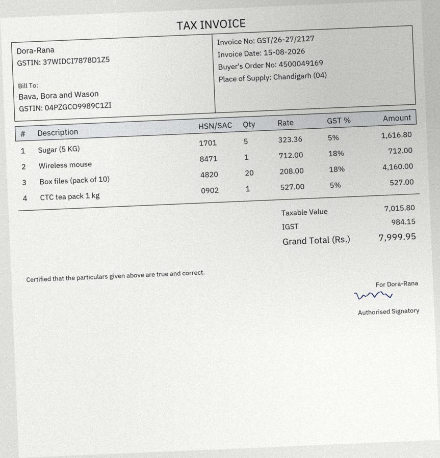
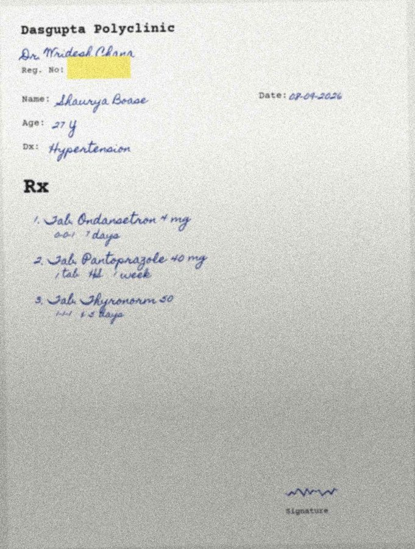
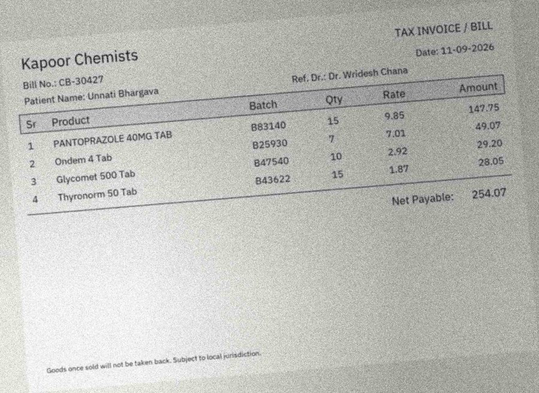

# PaperTrail benchmark

Generated by `python -m bench.report` from `bench/results/*.json`. Every number below comes from a run saved in this folder; anything not yet run reads TBD.

## Claims

Test set: 60 synthetic pairs (seed 7): 30 without discrepancies; tiers {'clean': 24, 'hard': 15, 'scanned': 21}.

### Headline

| Configuration | Pairs | Extraction F1 (exact / norm.) | Discrepancy precision | Discrepancy recall | False alarms on clean pairs | Decision accuracy | Tokens / pair | Model latency p50 / p95 |
|---|---|---|---|---|---|---|---|---|
| VLM direct + rules | TBD | TBD | TBD | TBD | TBD | TBD | TBD | TBD |
| VLM direct + rules+LLM | TBD | TBD | TBD | TBD | TBD | TBD | TBD | TBD |
| VLM B + rules+LLM (no second vision model available on Groq) | TBD | TBD | TBD | TBD | TBD | TBD | TBD | TBD |
| OCR+LLM + rules+LLM | 15 of 60 | 70.2% / 72.0% | 45.5% | 50.0% | 33.3% | 20.0% | 3,147 | 4.2s / 5.8s |
| Oracle (ground truth) + rules | 60 | n/a (ground truth) | 67.2% | 97.7% | 46.7% | 76.7% | n/a | n/a |
| Oracle (ground truth) + rules+LLM | 60 | n/a (ground truth) | 95.6% | 97.7% | 6.7% | 96.7% | TBD | n/a |

Field-validation catch rate (OCR+LLM + rules+LLM): `arithmetic_error` 50.0%

### Recall per discrepancy type

| Discrepancy type | Seeded | OCR+LLM + rules+LLM R / P | Oracle (ground truth) + rules R / P | Oracle (ground truth) + rules+LLM R / P |
|---|---|---|---|---|
| `unprescribed_medicine` | 9 | 0.0% / 0.0% | 100.0% / 30.0% | 100.0% / 90.0% |
| `patient_name_mismatch` | 9 | 50.0% / 66.7% | 100.0% / 100.0% | 100.0% / 100.0% |
| `bill_before_prescription` | 8 | 100.0% / 100.0% | 100.0% / 100.0% | 100.0% / 100.0% |
| `implausible_quantity` | 9 | 50.0% / 100.0% | 88.9% / 100.0% | 88.9% / 88.9% |
| `arithmetic_error` | 9 | 50.0% / 33.3% | 100.0% / 100.0% | 100.0% / 100.0% |

### Error attribution (oracle vs real)

Each missed or false discrepancy in a real run is attributed to **extraction** if the oracle run (ground-truth documents, same matching mode) got that pair right, else to **matching/logic**.

| Configuration | Missed: extraction | Missed: matching/logic | False alarm: extraction | False alarm: matching/logic |
|---|---|---|---|---|
| OCR+LLM + rules+LLM (vs Oracle (ground truth) + rules+LLM) | 5 | 0 | 6 | 0 |

### Extraction F1 (normalised) by document and tier

| Document | Tier | OCR+LLM + rules+LLM |
|---|---|---|
| bill | clean | 95.6% |
| bill | scanned | 95.2% |
| bill | hard | 2.1% |
| prescription | clean | 74.7% |
| prescription | scanned | 63.3% |
| prescription | hard | 2.6% |

### Confidence calibration (critical fields)

| Configuration | Critical fields scored | Accuracy when conf >= 0.75 | Accuracy when conf < 0.75 | Share of wrong fields caught by low confidence |
|---|---|---|---|---|
| OCR+LLM + rules+LLM | 206 | 86.4% | 60.0% | 18.8% |

### Decisions

**OCR+LLM + rules+LLM**: accuracy 20.0%; discrepant pairs not auto-approved 100.0%; clean pairs auto-approved 0.0%; clean pairs flagged 33.3%

| expected \ predicted | approve | needs_review | flag |
|---|---|---|---|
| approve | 0 | 6 | 3 |
| flag | 0 | 3 | 3 |

**Oracle (ground truth) + rules+LLM**: accuracy 96.7%; discrepant pairs not auto-approved 100.0%; clean pairs auto-approved 93.3%; clean pairs flagged 6.7%

| expected \ predicted | approve | needs_review | flag |
|---|---|---|---|
| approve | 28 | 0 | 2 |
| flag | 0 | 0 | 30 |

## Payables

Test set: 60 synthetic pairs (seed 7): 30 without discrepancies; tiers {'scanned': 21, 'clean': 24, 'hard': 15}.

### Headline

| Configuration | Pairs | Extraction F1 (exact / norm.) | Discrepancy precision | Discrepancy recall | False alarms on clean pairs | Decision accuracy | Tokens / pair | Model latency p50 / p95 |
|---|---|---|---|---|---|---|---|---|
| VLM direct + rules | TBD | TBD | TBD | TBD | TBD | TBD | TBD | TBD |
| VLM direct + rules+LLM | TBD | TBD | TBD | TBD | TBD | TBD | TBD | TBD |
| VLM B + rules+LLM (no second vision model available on Groq) | TBD | TBD | TBD | TBD | TBD | TBD | TBD | TBD |
| OCR+LLM + rules+LLM | 15 of 60 | 80.7% / 81.2% | 26.9% | 77.8% | 71.4% | 53.3% | 3,592 | 4.8s / 6.1s |
| Oracle (ground truth) + rules | 60 | n/a (ground truth) | 92.3% | 97.3% | 3.3% | 98.3% | n/a | n/a |
| Oracle (ground truth) + rules+LLM | 60 | n/a (ground truth) | 100.0% | 100.0% | 0.0% | 100.0% | TBD | n/a |

Field-validation catch rate (OCR+LLM + rules+LLM): `invalid_gstin` 100.0%, `total_mismatch` 100.0%

### Recall per discrepancy type

| Discrepancy type | Seeded | OCR+LLM + rules+LLM R / P | Oracle (ground truth) + rules R / P | Oracle (ground truth) + rules+LLM R / P |
|---|---|---|---|---|
| `gstin_mismatch` | 5 | 50.0% / 12.5% | 100.0% / 100.0% | 100.0% / 100.0% |
| `invalid_gstin` | 5 | 100.0% / 16.7% | 100.0% / 100.0% | 100.0% / 100.0% |
| `rate_above_po` | 5 | 100.0% / 100.0% | 80.0% / 100.0% | 100.0% / 100.0% |
| `qty_over_po` | 6 | TBD / 0.0% | 100.0% / 100.0% | 100.0% / 100.0% |
| `line_not_on_po` | 5 | 0.0% / TBD | 100.0% / 62.5% | 100.0% / 100.0% |
| `wrong_tax_split` | 6 | 100.0% / 100.0% | 100.0% / 100.0% | 100.0% / 100.0% |
| `total_mismatch` | 5 | 100.0% / 100.0% | 100.0% / 100.0% | 100.0% / 100.0% |

### Error attribution (oracle vs real)

Each missed or false discrepancy in a real run is attributed to **extraction** if the oracle run (ground-truth documents, same matching mode) got that pair right, else to **matching/logic**.

| Configuration | Missed: extraction | Missed: matching/logic | False alarm: extraction | False alarm: matching/logic |
|---|---|---|---|---|
| OCR+LLM + rules+LLM (vs Oracle (ground truth) + rules+LLM) | 2 | 0 | 19 | 0 |

### Extraction F1 (normalised) by document and tier

| Document | Tier | OCR+LLM + rules+LLM |
|---|---|---|
| invoice | clean | 91.4% |
| invoice | scanned | 92.5% |
| invoice | hard | 6.8% |
| purchase_order | clean | 92.8% |
| purchase_order | scanned | 89.2% |
| purchase_order | hard | 13.5% |

### Confidence calibration (critical fields)

| Configuration | Critical fields scored | Accuracy when conf >= 0.75 | Accuracy when conf < 0.75 | Share of wrong fields caught by low confidence |
|---|---|---|---|---|
| OCR+LLM + rules+LLM | 313 | 95.9% | 63.4% | 72.2% |

### Decisions

**OCR+LLM + rules+LLM**: accuracy 53.3%; discrepant pairs not auto-approved 100.0%; clean pairs auto-approved 0.0%; clean pairs flagged 71.4%

| expected \ predicted | approve | needs_review | flag |
|---|---|---|---|
| approve | 0 | 2 | 5 |
| flag | 0 | 0 | 8 |

**Oracle (ground truth) + rules+LLM**: accuracy 100.0%; discrepant pairs not auto-approved 100.0%; clean pairs auto-approved 100.0%; clean pairs flagged 0.0%

| expected \ predicted | approve | needs_review | flag |
|---|---|---|---|
| approve | 30 | 0 | 0 |
| flag | 0 | 0 | 30 |

## Top failure patterns

**1. OCR+LLM + rules+LLM: `prescription.medicines[*].name` misread (wrong value)**: 21 occurrences. Example `cla-000` (clean): `medicines[2].name` truth `Allegra 120`, got `Allegra`.

Diagnosis: _auto:_ OCR+LLM + rules+LLM: `prescription.medicines[*].name` misread (wrong value)

**2. OCR+LLM + rules+LLM: `prescription.medicines[*].duration` dropped (left null)**: 20 occurrences. Example `cla-000` (clean): `medicines[0].duration` truth `7 days`, got `None`.

Diagnosis: _auto:_ OCR+LLM + rules+LLM: `prescription.medicines[*].duration` dropped (left null)

**3. OCR+LLM + rules+LLM: `prescription.medicines[*].strength` misread (wrong value)**: 20 occurrences. Example `cla-000` (clean): `medicines[0].strength` truth `500 mg`, got `599 mg`.

Diagnosis: _auto:_ OCR+LLM + rules+LLM: `prescription.medicines[*].strength` misread (wrong value)

**4. OCR+LLM + rules+LLM: `invoice.line_items[*].qty` dropped (left null)**: 19 occurrences. Example `pay-000` (scanned): `line_items[3].qty` truth `1.0`, got `None`.

Diagnosis: _auto:_ OCR+LLM + rules+LLM: `invoice.line_items[*].qty` dropped (left null)

**5. OCR+LLM + rules+LLM: `prescription.medicines[*].frequency` dropped (left null)**: 18 occurrences. Example `cla-002` (hard): `medicines[0].frequency` truth `0-0-1`, got `None`.

Diagnosis: _auto:_ OCR+LLM + rules+LLM: `prescription.medicines[*].frequency` dropped (left null)

**6. OCR+LLM + rules+LLM: `purchase_order.line_items[*].qty` dropped (left null)**: 17 occurrences. Example `pay-001` (scanned): `line_items[1].qty` truth `1.0`, got `None`.

Diagnosis: _auto:_ OCR+LLM + rules+LLM: `purchase_order.line_items[*].qty` dropped (left null)

**7. OCR+LLM + rules+LLM: `bill.line_items[*].amount` dropped (left null)**: 16 occurrences. Example `cla-002` (hard): `line_items[0].amount` truth `147.75`, got `None`.

Diagnosis: _auto:_ OCR+LLM + rules+LLM: `bill.line_items[*].amount` dropped (left null)

**8. OCR+LLM + rules+LLM: `bill.line_items[*].rate` dropped (left null)**: 16 occurrences. Example `cla-002` (hard): `line_items[0].rate` truth `9.85`, got `None`.

Diagnosis: _auto:_ OCR+LLM + rules+LLM: `bill.line_items[*].rate` dropped (left null)

**9. OCR+LLM + rules+LLM: `purchase_order.line_items[*].rate` dropped (left null)**: 16 occurrences. Example `pay-001` (scanned): `line_items[0].rate` truth `1277.0`, got `None`.

Diagnosis: _auto:_ OCR+LLM + rules+LLM: `purchase_order.line_items[*].rate` dropped (left null)

**10. OCR+LLM + rules+LLM: `prescription.medicines[*].name` dropped (left null)**: 15 occurrences. Example `cla-002` (hard): `medicines[0].name` truth `Ondansetron`, got `None`.

Diagnosis: _auto:_ OCR+LLM + rules+LLM: `prescription.medicines[*].name` dropped (left null)

## Dev-set notes (not the reported test set)

- `claims__oracle_llm__match-gpt-oss-120b`: precision 90.9%, recall 100.0%, clean-pair false alarms 6.7%
- `claims__oracle_llm__match-gpt-oss-20b`: precision 87.0%, recall 100.0%, clean-pair false alarms 10.0%
