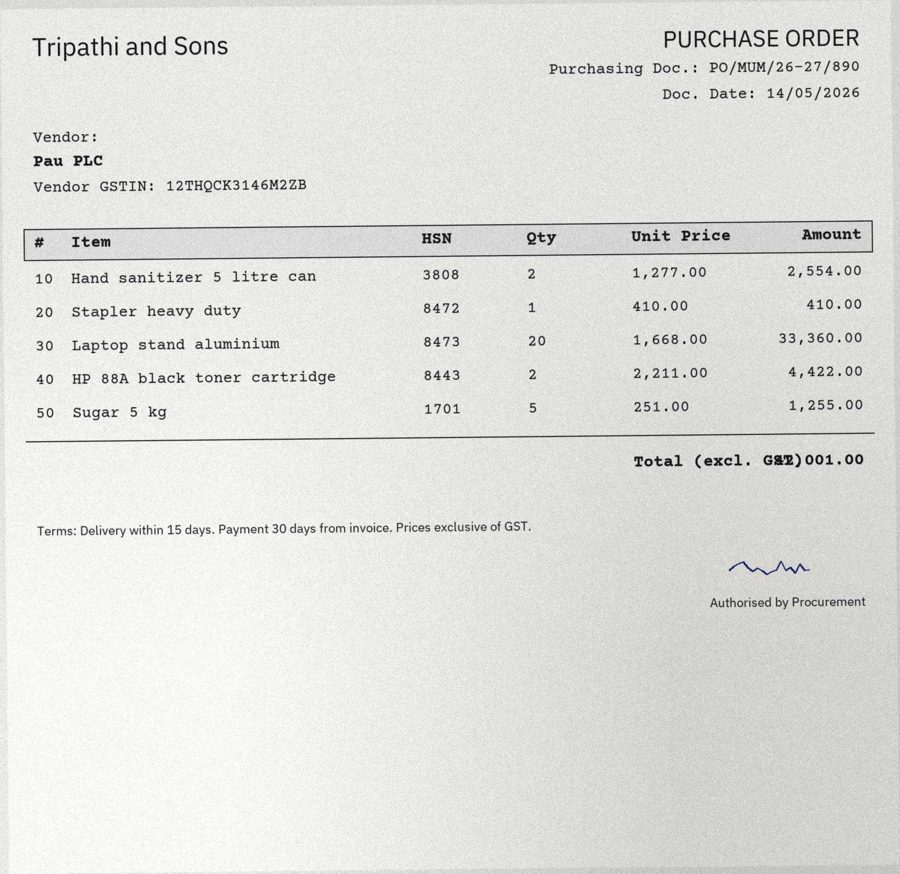
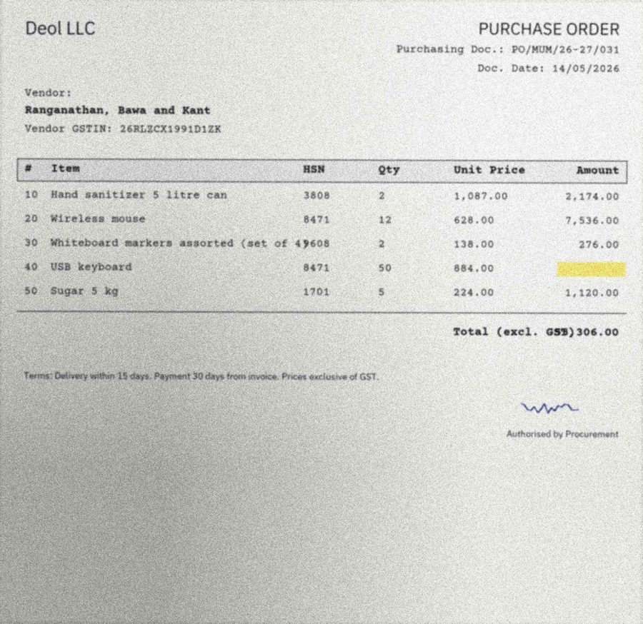
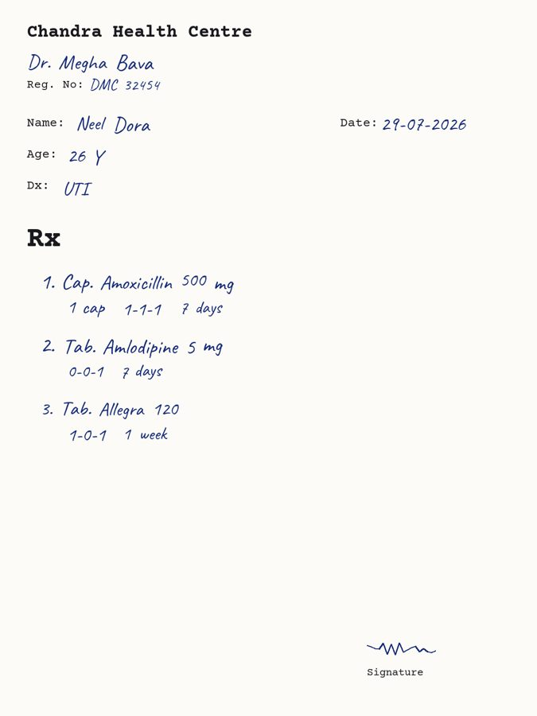

# PaperTrail benchmark

Generated by `python -m bench.report` from `bench/results/*.json`. Every number below comes from a run saved in this folder; anything not yet run reads TBD.

## Claims

Test set: 60 synthetic pairs (seed 7): 30 without discrepancies; tiers {'clean': 24, 'hard': 15, 'scanned': 21}.

### Headline

| Configuration | Pairs | Extraction F1 (exact / norm.) | Discrepancy precision | Discrepancy recall | False alarms on clean pairs | Decision accuracy | Tokens / pair | Model latency p50 / p95 |
|---|---|---|---|---|---|---|---|---|
| VLM direct + rules | TBD | TBD | TBD | TBD | TBD | TBD | TBD | TBD |
| VLM direct + rules+LLM | 45 of 60 | 90.0% / 91.5% | 82.6% | 100.0% | 36.8% | 82.2% | 6,162 | 4.0s / 11.3s |
| VLM B + rules+LLM (no second vision model available on Groq) | TBD | TBD | TBD | TBD | TBD | TBD | TBD | TBD |
| OCR+LLM + rules+LLM | 60 | 70.3% / 72.1% | 55.8% | 65.9% | 33.3% | 36.7% | 3,033 | 4.1s / 9.9s |
| Oracle (ground truth) + rules | 60 | n/a (ground truth) | 67.2% | 97.7% | 46.7% | 76.7% | n/a | n/a |
| Oracle (ground truth) + rules+LLM | 60 | n/a (ground truth) | 95.6% | 97.7% | 6.7% | 96.7% | n/a | n/a |

Field-validation catch rate (VLM direct + rules+LLM): `arithmetic_error` 100.0%

### Recall per discrepancy type

| Discrepancy type | Seeded | VLM direct + rules+LLM R / P | OCR+LLM + rules+LLM R / P | Oracle (ground truth) + rules R / P | Oracle (ground truth) + rules+LLM R / P |
|---|---|---|---|---|---|
| `unprescribed_medicine` | 9 | 100.0% / 57.1% | 55.6% / 41.7% | 100.0% / 30.0% | 100.0% / 90.0% |
| `patient_name_mismatch` | 9 | 100.0% / 100.0% | 77.8% / 58.3% | 100.0% / 100.0% | 100.0% / 100.0% |
| `bill_before_prescription` | 8 | 100.0% / 100.0% | 50.0% / 66.7% | 100.0% / 100.0% | 100.0% / 100.0% |
| `implausible_quantity` | 9 | 100.0% / 77.8% | 66.7% / 75.0% | 88.9% / 100.0% | 88.9% / 88.9% |
| `arithmetic_error` | 9 | 100.0% / 100.0% | 77.8% / 50.0% | 100.0% / 100.0% | 100.0% / 100.0% |

### Error attribution (oracle vs real)

Each missed or false discrepancy in a real run is attributed to **extraction** if the oracle run (ground-truth documents, same matching mode) got that pair right, else to **matching/logic**.

| Configuration | Missed: extraction | Missed: matching/logic | False alarm: extraction | False alarm: matching/logic |
|---|---|---|---|---|
| VLM direct + rules+LLM (vs Oracle (ground truth) + rules+LLM) | 0 | 0 | 6 | 2 |
| OCR+LLM + rules+LLM (vs Oracle (ground truth) + rules+LLM) | 14 | 1 | 22 | 1 |

### Extraction F1 (normalised) by document and tier

| Document | Tier | VLM direct + rules+LLM | OCR+LLM + rules+LLM |
|---|---|---|---|
| bill | clean | 99.5% | 97.2% |
| bill | scanned | 99.3% | 95.1% |
| bill | hard | 97.3% | 12.2% |
| prescription | clean | 85.0% | 70.5% |
| prescription | scanned | 83.0% | 68.4% |
| prescription | hard | 80.8% | 5.0% |

### Confidence calibration (critical fields)

| Configuration | Critical fields scored | Accuracy when conf >= 0.75 | Accuracy when conf < 0.75 | Share of wrong fields caught by low confidence |
|---|---|---|---|---|
| VLM direct + rules+LLM | 776 | 91.6% | 0.0% | 1.5% |
| OCR+LLM + rules+LLM | 751 | 88.2% | 51.7% | 25.5% |

### Decisions

**VLM direct + rules+LLM**: accuracy 82.2%; discrepant pairs not auto-approved 100.0%; clean pairs auto-approved 57.9%; clean pairs flagged 36.8%

| expected \ predicted | approve | needs_review | flag |
|---|---|---|---|
| approve | 11 | 1 | 7 |
| flag | 0 | 0 | 26 |

**OCR+LLM + rules+LLM**: accuracy 36.7%; discrepant pairs not auto-approved 100.0%; clean pairs auto-approved 6.7%; clean pairs flagged 33.3%

| expected \ predicted | approve | needs_review | flag |
|---|---|---|---|
| approve | 2 | 18 | 10 |
| flag | 0 | 10 | 20 |

**Oracle (ground truth) + rules+LLM**: accuracy 96.7%; discrepant pairs not auto-approved 100.0%; clean pairs auto-approved 93.3%; clean pairs flagged 6.7%

| expected \ predicted | approve | needs_review | flag |
|---|---|---|---|
| approve | 28 | 0 | 2 |
| flag | 0 | 0 | 30 |

## Payables

Test set: 60 synthetic pairs (seed 7): 30 without discrepancies; tiers {'scanned': 21, 'clean': 24, 'hard': 15}.

### Headline

| Configuration | Pairs | Extraction F1 (exact / norm.) | Discrepancy precision | Discrepancy recall | False alarms on clean pairs | Decision accuracy | Tokens / pair | Model latency p50 / p95 |
|---|---|---|---|---|---|---|---|---|
| VLM direct + rules | TBD | TBD | TBD | TBD | TBD | TBD | TBD | TBD |
| VLM direct + rules+LLM | 40 of 60 | 94.7% / 94.8% | 51.1% | 92.0% | 40.0% | 72.5% | 5,497 | 4.7s / 23.0s |
| VLM B + rules+LLM (no second vision model available on Groq) | TBD | TBD | TBD | TBD | TBD | TBD | TBD | TBD |
| OCR+LLM + rules+LLM | 60 | 79.3% / 79.8% | 23.4% | 59.5% | 80.0% | 46.7% | 3,405 | 5.1s / 24.5s |
| Oracle (ground truth) + rules | 60 | n/a (ground truth) | 92.3% | 97.3% | 3.3% | 98.3% | n/a | n/a |
| Oracle (ground truth) + rules+LLM | 60 | n/a (ground truth) | 100.0% | 100.0% | 0.0% | 100.0% | n/a | n/a |

Field-validation catch rate (VLM direct + rules+LLM): `invalid_gstin` 100.0%, `total_mismatch` 100.0%

### Recall per discrepancy type

| Discrepancy type | Seeded | VLM direct + rules+LLM R / P | OCR+LLM + rules+LLM R / P | Oracle (ground truth) + rules R / P | Oracle (ground truth) + rules+LLM R / P |
|---|---|---|---|---|---|
| `gstin_mismatch` | 5 | 75.0% / 33.3% | 60.0% / 11.5% | 100.0% / 100.0% | 100.0% / 100.0% |
| `invalid_gstin` | 5 | 100.0% / 26.3% | 100.0% / 10.9% | 100.0% / 100.0% | 100.0% / 100.0% |
| `rate_above_po` | 5 | 66.7% / 100.0% | 40.0% / 66.7% | 80.0% / 100.0% | 100.0% / 100.0% |
| `qty_over_po` | 6 | 100.0% / 100.0% | 33.3% / 50.0% | 100.0% / 100.0% | 100.0% / 100.0% |
| `line_not_on_po` | 5 | 100.0% / 75.0% | 60.0% / 50.0% | 100.0% / 62.5% | 100.0% / 100.0% |
| `wrong_tax_split` | 6 | 100.0% / 100.0% | 33.3% / 100.0% | 100.0% / 100.0% | 100.0% / 100.0% |
| `total_mismatch` | 5 | 100.0% / 75.0% | 100.0% / 71.4% | 100.0% / 100.0% | 100.0% / 100.0% |

### Error attribution (oracle vs real)

Each missed or false discrepancy in a real run is attributed to **extraction** if the oracle run (ground-truth documents, same matching mode) got that pair right, else to **matching/logic**.

| Configuration | Missed: extraction | Missed: matching/logic | False alarm: extraction | False alarm: matching/logic |
|---|---|---|---|---|
| VLM direct + rules+LLM (vs Oracle (ground truth) + rules+LLM) | 2 | 0 | 22 | 0 |
| OCR+LLM + rules+LLM (vs Oracle (ground truth) + rules+LLM) | 15 | 0 | 72 | 0 |

### Extraction F1 (normalised) by document and tier

| Document | Tier | VLM direct + rules+LLM | OCR+LLM + rules+LLM |
|---|---|---|---|
| invoice | clean | 97.5% | 92.0% |
| invoice | scanned | 98.1% | 92.1% |
| invoice | hard | 82.7% | 5.1% |
| purchase_order | clean | 97.6% | 92.8% |
| purchase_order | scanned | 98.0% | 88.1% |
| purchase_order | hard | 83.4% | 15.2% |

### Confidence calibration (critical fields)

| Configuration | Critical fields scored | Accuracy when conf >= 0.75 | Accuracy when conf < 0.75 | Share of wrong fields caught by low confidence |
|---|---|---|---|---|
| VLM direct + rules+LLM | 893 | 97.9% | TBD | 0.0% |
| OCR+LLM + rules+LLM | 1039 | 95.9% | 56.6% | 70.1% |

### Decisions

**VLM direct + rules+LLM**: accuracy 72.5%; discrepant pairs not auto-approved 100.0%; clean pairs auto-approved 50.0%; clean pairs flagged 40.0%

| expected \ predicted | approve | needs_review | flag |
|---|---|---|---|
| approve | 10 | 2 | 8 |
| flag | 0 | 1 | 19 |

**OCR+LLM + rules+LLM**: accuracy 46.7%; discrepant pairs not auto-approved 100.0%; clean pairs auto-approved 0.0%; clean pairs flagged 80.0%

| expected \ predicted | approve | needs_review | flag |
|---|---|---|---|
| approve | 0 | 6 | 24 |
| flag | 0 | 2 | 28 |

**Oracle (ground truth) + rules+LLM**: accuracy 100.0%; discrepant pairs not auto-approved 100.0%; clean pairs auto-approved 100.0%; clean pairs flagged 0.0%

| expected \ predicted | approve | needs_review | flag |
|---|---|---|---|
| approve | 30 | 0 | 0 |
| flag | 0 | 0 | 30 |

## Top failure patterns

**1. OCR+LLM + rules+LLM: `prescription.medicines[*].strength` misread (wrong value)**: 69 occurrences. Example `cla-000` (clean): `medicines[0].strength` truth `500 mg`, got `599 mg`.

Diagnosis: _auto:_ OCR+LLM + rules+LLM: `prescription.medicines[*].strength` misread (wrong value)

**2. OCR+LLM + rules+LLM: `prescription.medicines[*].name` misread (wrong value)**: 67 occurrences. Example `cla-000` (clean): `medicines[2].name` truth `Allegra 120`, got `Allegra`.

Diagnosis: _auto:_ OCR+LLM + rules+LLM: `prescription.medicines[*].name` misread (wrong value)

**3. OCR+LLM + rules+LLM: `invoice.line_items[*].qty` dropped (left null)**: 64 occurrences. Example `pay-000` (scanned): `line_items[3].qty` truth `1.0`, got `None`.

Diagnosis: _auto:_ OCR+LLM + rules+LLM: `invoice.line_items[*].qty` dropped (left null)

**4. OCR+LLM + rules+LLM: `prescription.medicines[*].duration` dropped (left null)**: 62 occurrences. Example `cla-000` (clean): `medicines[0].duration` truth `7 days`, got `None`.

Diagnosis: _auto:_ OCR+LLM + rules+LLM: `prescription.medicines[*].duration` dropped (left null)

**5. OCR+LLM + rules+LLM: `purchase_order.line_items[*].rate` dropped (left null)**: 60 occurrences. Example `pay-001` (scanned): `line_items[0].rate` truth `1277.0`, got `None`.

Diagnosis: _auto:_ OCR+LLM + rules+LLM: `purchase_order.line_items[*].rate` dropped (left null)

**6. OCR+LLM + rules+LLM: `purchase_order.line_items[*].qty` dropped (left null)**: 60 occurrences. Example `pay-001` (scanned): `line_items[1].qty` truth `1.0`, got `None`.

Diagnosis: _auto:_ OCR+LLM + rules+LLM: `purchase_order.line_items[*].qty` dropped (left null)

**7. OCR+LLM + rules+LLM: `purchase_order.line_items[*].hsn` dropped (left null)**: 60 occurrences. Example `pay-004` (hard): `line_items[0].hsn` truth `3808`, got `None`.

Diagnosis: _auto:_ OCR+LLM + rules+LLM: `purchase_order.line_items[*].hsn` dropped (left null)

**8. VLM direct + rules+LLM: `prescription.medicines[*].strength` misread (wrong value)**: 59 occurrences. Example `cla-000` (clean): `medicines[2].strength` truth `None`, got `120`.

Diagnosis: _auto:_ VLM direct + rules+LLM: `prescription.medicines[*].strength` misread (wrong value)

**9. VLM direct + rules+LLM: `prescription.medicines[*].name` misread (wrong value)**: 58 occurrences. Example `cla-000` (clean): `medicines[2].name` truth `Allegra 120`, got `Allegra`.

Diagnosis: _auto:_ VLM direct + rules+LLM: `prescription.medicines[*].name` misread (wrong value)

**10. OCR+LLM + rules+LLM: `prescription.medicines[*].frequency` dropped (left null)**: 56 occurrences. Example `cla-002` (hard): `medicines[0].frequency` truth `0-0-1`, got `None`.

Diagnosis: _auto:_ OCR+LLM + rules+LLM: `prescription.medicines[*].frequency` dropped (left null)

## Dev-set notes (not the reported test set)

- `claims__oracle_llm__match-gpt-oss-120b`: precision 90.9%, recall 100.0%, clean-pair false alarms 6.7%
- `claims__oracle_llm__match-gpt-oss-20b`: precision 87.0%, recall 100.0%, clean-pair false alarms 10.0%
